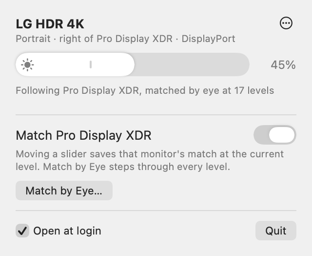

# Brightside

A macOS menu bar app for the brightness of external monitors that macOS can't dim, and for keeping them matched to an Apple display beside them.

<picture>
  <source media="(prefers-color-scheme: dark)" srcset="docs/panel-dark.png">
  
</picture>

## What it's for

macOS dims Apple displays with the brightness keys and Control Center, but most other monitors only change brightness through their own buttons. Brightside puts a slider for each of them in the menu bar.

- **It sets the monitor's own backlight** over DDC/CI, the same setting its buttons change.
- **It goes darker than the monitor allows.** Below backlight 0, it keeps dimming the picture, down to about 3% of the light.
- **It matches an Apple display.** If a Pro Display XDR or Studio Display sits beside your other monitors, Brightside makes them follow its brightness, whatever changes it: the brightness keys, Control Center or auto-brightness.
- **You tune the match by eye.** Monitors differ, so you set where each one sits at each of the Apple display's brightness levels, and Brightside remembers and blends between them.

## Requirements

- A Mac with Apple silicon, on macOS 14 or later. It was built and tested on macOS 27.
- The Xcode Command Line Tools (`xcode-select --install`). Xcode itself isn't needed.
- Monitors with DDC/CI turned on. Most ship with it on; some have a setting for it in their own menu. A monitor without it can still use software dimming.

## Install

```
git clone https://github.com/rgbwavesdev/Brightside.git
cd Brightside
./build.sh
```

`build.sh` compiles the app with `swiftc`, signs it ad hoc and installs it to `~/Applications/Brightside.app`. Open it from there and a sun appears in the menu bar. Because you built it on your own Mac, Gatekeeper doesn't block it.

To start it with your Mac, tick **Open at login** at the bottom of its panel.

## Using it

### Sliders

- Click the **sun** in the menu bar. Each non-Apple monitor gets a slider: click anywhere on it or drag. Each one is labeled with its position and connection ("Portrait · right of Pro Display XDR · DisplayPort"), which tells two identical monitors apart.
- The top 70% of a slider is the monitor's backlight, 0 to 100. A small tick marks where the backlight bottoms out. Below the tick, the backlight stays at 0 and Brightside darkens the picture instead, and the sun turns into a moon. The darker range comes back by itself after sleep, display changes and relaunching.
- With two or more monitors, **Move both sliders together** makes one slider move them all by the same amount, like linked faders. Monitors at the same place stay together; ones you've set apart keep their difference. If a drag pushes one against 0 or 100, it comes back when you drag back.
- The **⋯** menu on each monitor chooses how it's dimmed:
  - **Monitor backlight (DDC)**, the default: the monitor's own brightness setting.
  - **Software dimming**: darkens the picture through the display's gamma table. It works on any screen, but the backlight stays on. Use it for a monitor that ignores DDC.
  - **Dim Past Backlight Minimum**, on by default: the darker range below the tick. Turn it off and the slider is just the backlight's 0–100.
  - **Read Level from Monitor**: re-reads the monitor's brightness. Brightside also does this each time the panel opens, so changes made with the monitor's buttons show up.
  - **Forget Matches by Eye**: puts the monitor back on the starting curve (see below).

### Matching an Apple display

With an Apple display connected, the panel shows a **Match** switch for it. Turned on, every monitor follows that display's brightness.

- **The starting curve.** Half brightness on the Apple display puts the monitors at the tick (backlight 0). Above that, the Apple display's slider maps onto the backlight. Below it, the darker range follows the Apple display's light output, which rises fast from its darkest setting. It's a starting point; matching by eye corrects it.
- **Matching by eye.** Move a monitor's slider while matching, and that becomes its match for the Apple display's current level. Between levels you've matched, Brightside blends from one match to the next. Below your lowest match it eases back to the starting curve at the darkest setting, and above your highest at the brightest, unless you've matched those too. The panel shows how many levels each monitor has ("Following Pro Display XDR, matched by eye at 17 levels").
- **Match by Eye…** walks through every level. It sets the Apple display to each of its 17 brightness-key levels in turn, darkest first. Move the sliders until the monitors look as bright as the Apple display, then click **Next** (or press Return) to save the level and go on. **Back** returns to the previous level, and **Stop** (or Escape) ends early and keeps what's saved. At the end, the Apple display goes back to its brightness from before. Each Next also clears any older matches between it and the neighboring levels, so one full pass leaves exactly one match per level.
- **Match by Eye needs auto-brightness off.** Auto-brightness doesn't keep a level another app sets: it pulls the Apple display back toward its own level, and the monitors slide along with it. With auto-brightness on, the button explains this and offers **Open Displays Settings** instead of starting. Turn "Automatically adjust brightness" off there for the walkthrough and back on afterwards if you like; everyday matching follows auto-brightness fine.
- A monitor on Software dimming, or with Dim Past Backlight Minimum off, starts from the Apple display's level one to one instead.
- The monitors' own buttons still work, but the next change on the Apple display moves them back to their matches. Turning the switch off leaves every monitor where it is.
- If the Apple display gets brighter than your monitors can, the top of its range can't be matched; the monitors stay at full brightness there. See [Tested setup](#tested-setup).

## How it works

- **DDC/CI over I²C.** Brightside talks to monitors through the private `IOAVService` calls in IOKit, the same ones [MonitorControl](https://github.com/MonitorControl/MonitorControl) and [m1ddc](https://github.com/waydabber/m1ddc) use on Apple silicon. Brightness is VCP code `0x10`.
  - Every packet is sent twice, because some monitors ignore a single send.
  - The checksum follows the spec (`0x6E ^ 0x51 ^ …`). A reply is accepted only if it starts `6E 88 02`, echoes the requested code, and its checksum matches.
  - Each monitor has its own queue that holds only the newest value, so a fast drag never piles up writes.
- **Finding each monitor's DDC channel.** CoreDisplay's `IODisplayLocation` gives each display's framebuffer path. The framebuffer is paired with the `DCPAVServiceProxy` that shares its `dispextN` name.
- **Software dimming and the darker range** scale the display's gamma table, starting from its existing calibration. Displays turn the signal into light at about the 2.2 power, so the darker range's floor (a signal of 0.2) leaves about 3% of the light. While a slider is in the darker range, nothing goes over DDC; the backlight just stays at 0. Gamma is reapplied after wake and display changes and checked every 3 seconds, and macOS restores the tables when the app quits.
- **Reading the Apple display.** The private DisplayServices framework, a thin client of `corebrightnessd`, gives its brightness slider (`DisplayServicesGetBrightness`) and the light that produces as a share of its maximum (`DisplayServicesGetLinearBrightness`). `DisplayServicesRegisterForBrightnessChangeNotifications` calls back within milliseconds of any change, and a check every 2 seconds catches one that goes missing.
- **The match curve.**
  - Starting curve: the Apple display's 0.5–1 maps to slider 30–100 (backlight 0–100). Below 0.5, the monitor's gamma signal is (light share ÷ light share at 0.5)^(1/2.2), so the monitor gives off the same share of its backlight-0 light.
  - Each match by eye stores the Apple display's slider and light, and where the monitor's slider was. At a matched level the slider lands exactly there. Elsewhere, each match's difference from the starting curve is blended in a straight line along the Apple display's slider, falling to zero at either end unless a match sits there.
  - A new match replaces any within 0.03 of it, just under half a key step. Matches are saved per monitor, keyed by vendor, model and serial number.
- **Steadiness.** Above the tick, a monitor moves only once its target is a whole point away, so auto-brightness creeping by fractions doesn't keep the DDC bus busy. In the darker range only gamma changes, so it follows within a quarter point.
- **Match by Eye** sets the Apple display with `DisplayServicesSetBrightness`, and reads `DisplayServicesAmbientLightCompensationEnabled` to see whether auto-brightness is on. Brightside never changes the auto-brightness setting itself. While Match by Eye runs, the panel stays open as you click around, and quitting puts the Apple display back.

### Source

| File | What's in it |
|---|---|
| `Sources/App.swift` | Entry point, menu bar item, panel |
| `Sources/Views.swift` | The panel (SwiftUI) |
| `Sources/Model.swift` | Monitors, matching, Match by Eye, Move Together |
| `Sources/DDC.swift` | DDC/CI over `IOAVService` |
| `Sources/Discovery.swift` | Finding displays and pairing them with DDC channels |
| `Sources/Gamma.swift` | Gamma-table dimming |
| `Sources/AppleBrightness.swift` | The Apple display's brightness, through DisplayServices |
| `Sources/CLI.swift` | Command-line mode |
| `Sources/ViewState.swift` | A stand-in for SwiftUI's `@State`, so the app builds without Xcode |
| `Tools/make_icon.swift` | Draws the app icon |
| `Tests/` | Model tests against fake displays |

## Limitations

- **Private APIs.** Brightside relies on `IOAVService`, CoreDisplay and DisplayServices, none of which Apple documents. A macOS update could break any of them.
- **Apple silicon only.** Intel Macs reach DDC another way, which Brightside doesn't implement.
- **Some connections only take DDC writes.** On some monitor and port combinations, reads come back scrambled. The slider then shows the last value Brightside set, and changes made with the monitor's buttons don't show up. The HDMI monitor in the tested setup is one.
- **Auto-brightness follows the room's light, and the monitors follow it.** Animated RGB lighting can make it pulse: in the tested setup, a slow rainbow effect on LED strips swung the XDR between 16 and 27 nits every 22 seconds, and the monitors swung with it. A static light scene, or auto-brightness off, keeps everything steady.

## Tested setup

An Apple silicon Mac on macOS 27 with a Pro Display XDR and two LG HDR 4K monitors in portrait, one on DisplayPort (DDC reads and writes work) and one on HDMI (writes only).

The XDR's light output by slider position, and where one full Match by Eye pass put both LGs (with Move Together on, so the two LGs also match each other):

| XDR slider | 0 | 1/16 | 2/16 | 4/16 | 6/16 | 8/16 | 11/16 | 12/16 | 16/16 |
|---|---|---|---|---|---|---|---|---|---|
| XDR nits | 4 | 16.5 | 27.5 | 55 | 92 | 140 | 240 | 281 | 500 |
| LG slider | 6% | 17% | 29% | 38% | 45% | 62% | 94% | 100% | 100% |
| LG setting | gamma 0.36 | gamma 0.66 | gamma 0.97 | backlight 11 | backlight 22 | backlight 46 | backlight 91 | backlight 100 | backlight 100 |

So these LGs give about 28 nits at backlight 0 and top out near 280. Above the XDR's 12/16 it keeps brightening to 500 nits and the LGs can't follow; at or below 12/16, all three match. At the XDR's darkest, 4 nits, the LGs matched with the backlight at 0 and the signal scaled to 0.36, which is what the darker range is for.

The starting curve came from an early side-by-side guess that an LG at backlight 0 looked like the XDR at 50% (140 nits). The pass above found it nearer 2/16, which is why matching by eye exists.

## Command line

The binary also has a headless mode for testing and scripting:

```
~/Applications/Brightside.app/Contents/MacOS/Brightside --list
~/Applications/Brightside.app/Contents/MacOS/Brightside --set 2 60        # display 2 from --list, 60%
~/Applications/Brightside.app/Contents/MacOS/Brightside --set all 40
~/Applications/Brightside.app/Contents/MacOS/Brightside --snapshot panel.png [--dark] [--match-by-eye]
```

- `--list` shows every display, how Brightside can control it, and its current level, including the Apple display's brightness and light output.
- `--set` sets a monitor's backlight over DDC.
- `--snapshot` renders the panel to a PNG through a window that never appears on screen. `--match-by-eye` renders it as it looks right after clicking Match by Eye, without changing the Apple display.

Run the binary inside the app bundle: a copy elsewhere reads a different settings domain, so it shows matching off and default levels.

## Testing

```
Tests/run-model-tests.sh
```

This runs the real `Sources/Model.swift` against fake displays (`Tests/ModelHarness/Fakes.swift`), so it never touches your monitors or the Apple display. It covers matching, Move Together, the auto-brightness check and a full Match by Eye pass.
